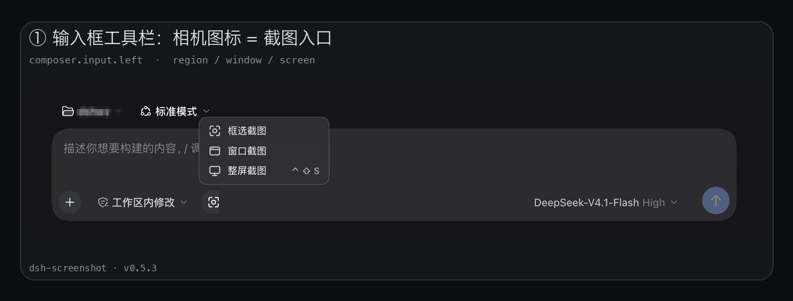
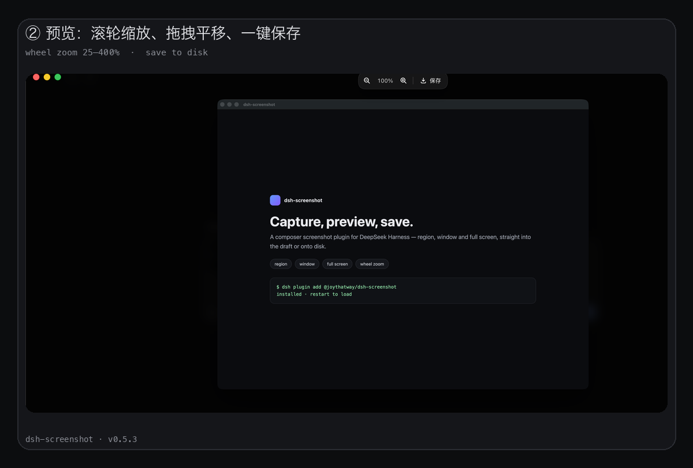
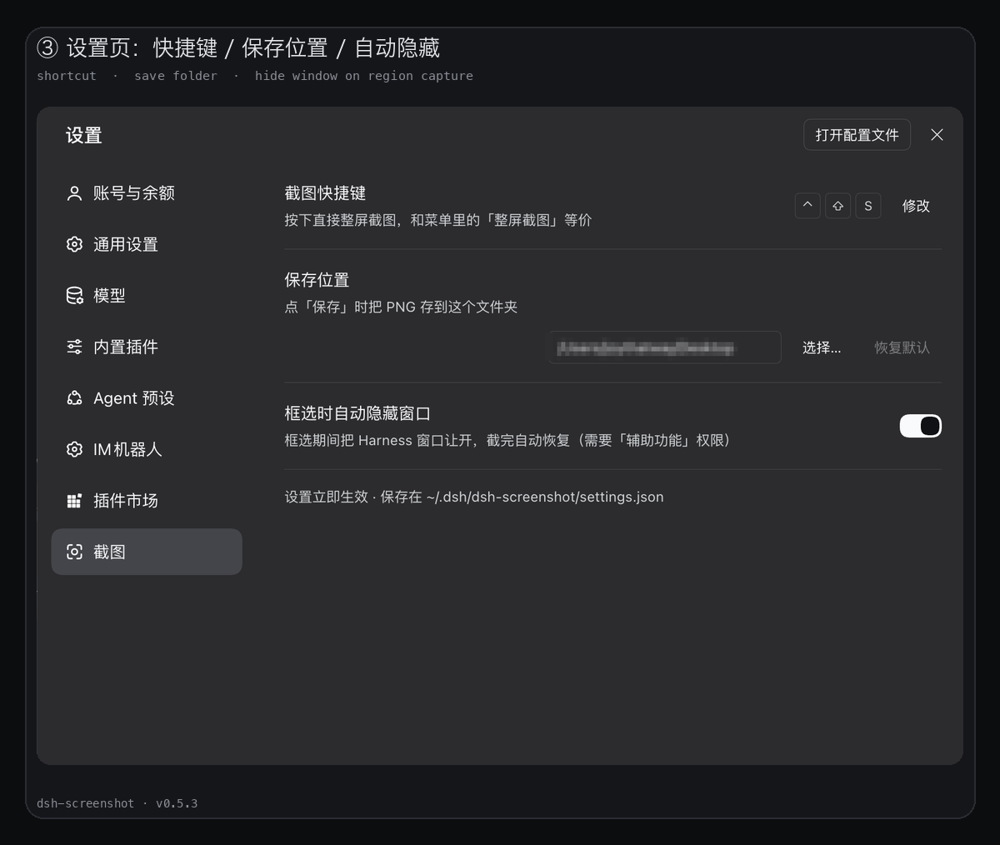

# 截图 · dsh-screenshot

给 [DeepSeek Harness](https://github.com/deepseek-ai/deepseek-harness) 的输入框工具栏加一个截图按钮：**框选 / 窗口 / 整屏**。截图可以作为草稿附件随消息发送，也可以保存到磁盘。

A composer-toolbar screenshot plugin for DeepSeek Harness — one button, three modes, captures into the draft or straight to disk.







## English

A composer-toolbar screenshot plugin for DeepSeek Harness: capture a region, a window, or the whole screen, then attach it to the draft or save it to disk.

- **One button, three modes** — region (the Harness window steps aside while you drag), a window list with live hover previews, or the whole screen.
- **Draft or disk** — captures land in the composer as a draft attachment, or save them to a folder you pick (Desktop by default).
- **Preview built in** — wheel zoom 25% – 400%, drag to pan, save straight from the preview.
- **Settings page** — change the shortcut (⌃⇧S by default), the save folder, and whether the window hides during a region capture.

---

## 功能

- **一个按钮，三种模式**：点输入框工具栏的相机图标，在菜单里选「框选截图 / 窗口截图 / 整屏截图」；菜单支持 ↑/↓/Home/End + Enter 键盘操作。
- **截图快捷键**：默认 **⌃⇧S**（Windows 为 **Ctrl+Shift+S**），按下直接整屏截图，不经过菜单；键位可以在设置页修改，也可以在 Harness 自己的快捷键页面修改。
- **框选**：
  - 调起系统原生遮罩拖出一块区域；
  - 截图前自动隐藏 Harness 窗口，便于框选被它遮挡的内容；截图结束（确认 / 取消 / 失败）后窗口自动恢复（可在设置里关闭）；
  - 松开鼠标后先弹确认框：Enter 确认入草稿、Esc 取消、点遮罩空白取消；确认框里也可以直接保存到磁盘（没有打开的会话时只有「保存 / 取消」）。
- **窗口**：
  - 列出当前屏幕上所有可见窗口（前台在前），悬停时显示该窗口的实时缩略图，预览跟随当前行移动；小于 100×80 的辅助窗口会被过滤；
  - 点一行截取整窗；对窗口快照读回纯色图的场景（例如部分 GPU 渲染窗口）会做空图检测（颜色跨度 + 标准差）：未被遮挡时按窗口矩形从屏幕合成中截取，被遮挡时提示先切到前台，不会返回黑图或纯色图；
  - 列表底部还有「改用鼠标点选窗口」：直接在屏幕上点某个窗口即可，**左键截图、右键 / Esc 取消**（也是列表没能列出目标窗口时的兜底）。
- **整屏**：直接截取整个桌面，无遮罩。
- **保存到磁盘**：
  - 框选确认框里有「保存」，图片预览里也有「保存」；
  - 默认保存到桌面，可在「设置 › 截图」里改成任意文件夹；
  - 文件名为 `screenshot-YYYYMMDD-HHMMSS.png`，重名自动追加 `-2`、`-3`；
  - 保存成功的提示带完整路径和「显示」，可直接在 Finder / 资源管理器中定位；提示 3 秒后自动消失，点击也能关闭；
  - 窗口 / 整屏截图不弹确认框，直接进草稿，同样可以在预览里保存。
- **设置页**：「设置 › 截图」（左下角设置 → 截图；插件管理器里该行的「配置」打开同一页面）：
  - **截图快捷键**：点「修改」后按下新组合键即生效，冲突或保留键会当场提示；「恢复默认」回到 ⌃⇧S；
  - **保存位置**：可手输路径，也可点「选择…」使用系统文件夹选择器；「恢复默认」回到桌面；
  - **框选时自动隐藏窗口**：关闭后框选期间不再隐藏 Harness 窗口；
  - 改动立即生效，不需要重启插件。目录与开关保存在 `$DSH_HOME/dsh-screenshot/settings.json`（默认 `~/.dsh/dsh-screenshot/settings.json`），快捷键绑定沿用 Harness 自己的 keybindings 存储。
- **图片预览**：点草稿里的截图缩略图打开预览层，单张截图同样适用：
  - 整屏深色遮罩 + 背景模糊，图片居中显示；
  - 顶部工具栏：缩小 · 百分比 · 放大 · 保存，点百分比回到 100%；
  - 鼠标滚轮直接缩放（上滚放大、下滚缩小），范围 25% – 400%，100% 为整张图刚好放得下的尺寸；
  - 放大后按住图片可拖动平移，缩放时视口自动对准图片中心；
  - 键盘：← / → 翻页，`+` / `-` 缩放，`0` 回到 100%，Esc 关闭；
  - 多张图片时顶部显示进度（如 `2 / 5`），底部缩略图条可点击跳转；
  - 「保存」把当前图片写入设置的目录，然后退出预览。
- **权限提示**：没有屏幕录制权限时给出说明和「打开设置」按钮，直接跳转到系统设置的对应面板。

## 平台支持

| 平台 | 框选 | 窗口（列表） | 整屏 | 状态 |
|---|---|---|---|---|
| macOS | 系统原生遮罩 | CoreGraphics + 悬停缩略图 | 原生截图 | **已实测** |
| Windows | 自绘遮罩（常驻 helper） | Win32 枚举 + PrintWindow | 常驻 helper + GDI | **已实测**（Windows 11） |
| Linux | — | — | — | 不支持（按钮隐藏） |

Windows 实现要点：

- 采集层是一个**常驻 PowerShell helper**（`capture/win/helper.ps1`）：`Add-Type` 只编译一次，之后所有截图命令走 stdin/stdout 的 JSON 行。整屏约 0.35 s、窗口约 0.3 s、窗口列表约 0.02 s（4K / 200% 缩放实测）。
- **不落盘**：helper 在内存里把 PNG 编码成 base64 直接回传宿主，截图不写临时文件，不会在磁盘上留下垃圾；只有点「保存」才会写你选的目录。
- **轻量**：helper 空闲 3 分钟自动退出，不在后台常驻；鼠标悬停截图按钮或打开菜单时会提前预热，下一次截图基本感觉不到启动。
- **框选**用 helper 里的 WinForms 遮罩：先抓一张全屏底图，再铺一层压暗的遮罩，拖拽出的区域显示原图；松手即裁切。**右键 / Esc 直接取消**。截屏前会隐藏 Harness 窗口（设置里可关），结束后恢复。
- **鼠标点选窗口**（窗口列表底部的「改用鼠标点选窗口」）：铺一层遮罩，鼠标移到哪个窗口就高亮哪个，左键截图、右键 / Esc 取消。点选时不隐藏 Harness 窗口——遮罩本来就盖住整屏，选中后按窗口内容截图，隐藏反而会让桌面窗口重新排布。
- **窗口截图**用 `PrintWindow(PW_RENDERFULLCONTENT)`，窗口被挡住也能截到内容；Win10/11 的不可见缩放边框会按 DWM 的可见框架裁掉，截图没有白边。个别 GPU 渲染窗口返回空图时会回退到屏幕矩形截取。
- **窗口列表**按「Alt-Tab 语义」过滤：跳过 DWM cloaked（其他虚拟桌面 / 被挂起的 UWP）、工具窗口、无激活窗口、被拥有的弹窗、shell 表面（任务栏、桌面、输入体验等）和屏幕外窗口。
- **界面适配**：Windows 桌面的菜单宽度按内容撑开（`Ctrl+Shift+S` 不会再把「整屏截图」挤成两行）；预览层整层标成 `no-drag` 并把顶部工具栏 / 关闭键下移到标题栏下方，避免落在窗口拖动区里点不动、或压到右上角的系统按钮。这些只对 Windows 桌面版生效，浏览器和 macOS 保持原样。

## 环境要求

- DeepSeek Harness（桌面版；浏览器中按钮可用，但快捷键只在桌面端绑定）
- macOS 12+（采集层使用 `screencapture`、`sips`、JXA/CoreGraphics）
- Windows 10 1809+ / Windows 11（采集层使用 `powershell.exe` + .NET Framework 4.8，系统自带，无需额外安装）
- Node.js ≥ 20（仅开发与测试需要）

## 安装

本插件是 Harness 的 profile bundle（`package.json` 中声明 `dsh.bundle.patch` 与 `dsh.client`）。

**方式一：插件管理器安装本地目录**

```text
plugin_manager install_bundle /绝对路径/dsh-screenshot
```

**方式二：手动放进 profile**

把目录拷到 `$DSH_PROFILE_DIR/node_modules/`，然后在 profile 的 `cordis.patch.yml` 中插入一行：

```yaml
- insert:
    - id: dsh-screenshot
      name: '@joythatway/dsh-screenshot'
```

安装后重启 Harness（或重新加载插件）；浏览器端代码在刷新页面后生效。

## 权限

| 权限 | 用途 | 缺失时的行为 |
|---|---|---|
| 屏幕录制 | 截图本身 | 提示并提供「打开设置」按钮，不会先铺遮罩再失败 |
| 辅助功能 | 框选 / 窗口点选时自动隐藏 Harness 窗口（可在设置中关闭） | 截图照常进行，只是不隐藏窗口；首次提示一次 |

插件使用 `CGPreflightScreenCaptureAccess()` 预检屏幕录制权限：只查询权限，不读取任何像素。

以上两项都是 macOS 的权限。Windows 没有对应的按应用授权：截图、框选遮罩、隐藏宿主窗口都不需要额外许可，装上就能用。

## 隐私与存储

- **截图默认不落盘**：PNG 只存在于宿主进程内存中，页面取走后即释放，60 秒未取自动清理；只有点击「保存」才会写入所选目录。
- **入草稿不等于保存**：图片加入输入框后只存在于页面内存（`File` + blob），发送时才写入附件库；不发送就关闭应用，不会在磁盘上留下文件。
- **缩略图不落盘**：按窗口号实时截取并缩放到 480px，最多内存缓存 16 张，30 秒过期。
- **入草稿前压缩**：长边超过 2560px 的截图会等比缩小，减少 token 与上传体积。
- **发送后的图片由 Harness 持久化**：发送后 Harness 的附件存储会写入 `$DSH_HOME/attachments/v1/objects/…`（内容哈希去重，默认不自动清理）。此行为由 Harness 提供，与插件无关。
- **设置文件**：`$DSH_HOME/dsh-screenshot/settings.json`，只包含保存目录与自动隐藏开关两个字段；文件损坏时按默认值处理。
- 所有 HTTP 路由只放行同源请求（校验 `sec-fetch-site`），并先经过 Harness 的 `connection.requestRejection`（Host/Origin 围栏 + 浏览器登录态）；保存接口只接受 PNG，文件名会去除路径分隔符。

## 快捷键

| 动作 | 键位 |
|---|---|
| 整屏截图 | ⌃⇧S / Ctrl+Shift+S（可在设置页修改） |
| 菜单内换行 / 触发 / 关闭 | ↑ ↓ Home End / Enter / Esc |
| 框选确认框：确认 / 取消 | Enter / Esc |
| 框选确认框（无会话时）：保存 / 取消 | Enter / Esc |
| 预览：翻页 / 缩放 / 重置 / 关闭 | ← → / + − / 0 / Esc |

## HTTP 接口（同源，供开发调试）

| 方法 | 路径 | 说明 |
|---|---|---|
| GET | `/api/dsh-screenshot/probe` | 平台能力：`supported` / `platform` / `modes` |
| POST | `/api/dsh-screenshot/warm` | 预热采集后端（Windows 用来提前拉起 helper），永远返回 `{ ok: true }` |
| GET | `/api/dsh-screenshot/windows` | 可见窗口列表（z 序，带坐标和尺寸） |
| GET | `/api/dsh-screenshot/thumbnail?id=<窗口号>` | 480px 窗口缩略图（PNG） |
| POST | `/api/dsh-screenshot/capture` | `{ mode: 'region'\|'window'\|'screen', windowId?, hideShell? }` → `{ ok, id }` |
| GET | `/api/dsh-screenshot/image/<id>` | 取一次即删的 PNG |
| GET | `/api/dsh-screenshot/settings` | 当前设置、生效的保存目录、默认（桌面）目录 |
| POST | `/api/dsh-screenshot/settings` | `{ saveDir?, hideOnCapture? }` → 写入并返回当前设置 |
| POST | `/api/dsh-screenshot/save?name=<文件名>` | 请求体为 PNG 原始字节 → `{ path, dir, name }` |
| POST | `/api/dsh-screenshot/reveal` | `{ path }` 在文件管理器中定位（只接受本次写出的文件） |
| POST | `/api/dsh-screenshot/settings-screen` | `{ pane: 'screen'\|'accessibility' }` 打开对应系统设置面板 |

## 项目结构

```text
index.js              Host 入口：HTTP 路由、内存暂存、保存与设置
capture/index.js      按平台选择采集后端
capture/macos.js      screencapture / sips / JXA（已实测）
capture/windows.js    Windows 后端：常驻 helper 的进程管理与协议
capture/win/helper.ps1  常驻 PowerShell helper：枚举 / 抓屏 / PrintWindow / 框选遮罩
lib/util.js           采集工具函数（可单测）
lib/settings.js       设置的默认值、校验与 JSON 持久化
client.js             浏览器端：按钮、菜单、确认框、预览、缩略图、设置页
test/util.test.js     采集工具函数单测
test/settings.test.js 设置校验单测
test/capture.test.js  采集后端接口契约 + 发布内容检查
test/host.test.js     Host 路由集成测试（临时目录写盘）
test/client.test.js   客户端冒烟测试（模块加载 / 槽位注册 / 页面渲染）
dev/                  Windows 真机调试脚本（不进 npm 包）
```

## 开发

```bash
npm test        # node --test，无第三方依赖
```

CI 配置在 `.github/workflows/test.yml`，push 时自动运行测试。

## 已知限制

- 依赖 Harness 的若干扩展点（`conversation.input.left` 槽位、`conversation` 服务的 `createDrafts` / `releaseDraftAttachment`、`shortcuts.register`）。升级 Harness 后建议把三种模式各点一次；异常通常是静默失效，不会导致界面崩溃。
- 快捷键只声明桌面端（`desktop:*`）：浏览器中 Ctrl+Shift+S 不是允许的浏览器组合，因此网页版不绑定这条命令，但设置页仍可修改桌面端的绑定。
- 「框选时自动隐藏窗口」在 macOS 与 Windows 都生效；Windows 通过隐藏宿主主窗口实现（按宿主进程的 pid 找：先试父进程，再试自己），都找不到时就退化为不隐藏，不会隐藏错窗口。
- Windows 的 helper 依赖系统自带的 Windows PowerShell 5.1 与 .NET Framework 4.8；启动脚本用 `-ExecutionPolicy Bypass`，不需要改系统执行策略，也不需要管理员权限。
- Windows helper 空闲 3 分钟会退出（可用环境变量 `DSH_SCREENSHOT_IDLE_MS` 调整毫秒数）；退出后第一次截图会有约 1 s 的启动/编译时间，悬停按钮或打开菜单会提前预热。helper 崩溃后下一次截图会自动重启它。
- 部分 GPU 渲染的窗口（某些浏览器、游戏、Electron 应用）`PrintWindow` 可能返回黑图，此时会回退到「按屏幕矩形截取」，被其他窗口挡住就会截到挡住的内容。
- Windows 的框选 / 点选遮罩最多停留 5 分钟：到点自己收掉并恢复被隐藏的窗口，避免宿主卡住时把整块屏幕一直盖着。
- 确认框和预览层没有焦点陷阱（鼠标可用；键盘支持 Enter/Esc 与预览的 ←/→）。
- 设置页的保存目录只校验是否为绝对路径，是否可写要等第一次保存时才知道（失败会提示检查目录）。

## License

MIT
